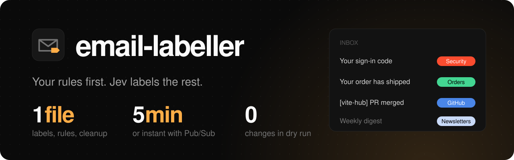

<h1>
  
</h1>

[](https://vitehub.dev)
[](https://typesafe.ai)
[](https://github.com/vite-hub/email-labeller/actions/workflows/check.yml)
[](./package.json)
[](./LICENSE)

Email labeller labels new Gmail Inbox messages, from a Cloudflare Worker or one Docker container. Your rules run first. When no rule matches, [Jev](https://typesafe.ai), TypeSafe's classification model, picks one of your labels from their descriptions and says how sure it is. Rules can also archive, mark as read, star, or trash, and a daily cleanup trashes old labelled mail. It starts in dry-run mode and changes nothing in Gmail until you turn that off.

[How it works](#how-it-works) · [Setup](#setup) · [Labels and rules](#labels-and-rules) · [Deploy](#deploy) · [Console](#console) · [Admin API](#admin-api) · [Cost](#cost) · [Limits](#limits)

An independent project by [@onmax](https://github.com/onmax), built on [ViteHub](https://vitehub.dev).

## How it works

```text
Gmail watch -> Pub/Sub -> Gmail Channel webhook ─┐
Cron every 5 minutes ───────────────────────┴─> sync Gmail history
  -> first matching rule, or Jev when none matches
  -> apply labels and actions (live mode only) -> save the Channel history cursor in durable state
Cron daily at 04:00 UTC -> trash labelled mail older than its cleanup age
```

Gmail access goes through [Executor](https://github.com/UsefulSoftwareCo/executor), which holds and refreshes the Google OAuth credential. Jev runs through Vercel AI Gateway as [`typesafe-ai/jev`](https://vercel.com/ai-gateway/models/jev). It sees a message only when no rule matches, and gets its headers, its current labels, and the first 1,000 characters of its plain-text body (`LABELLER_BODY_LIMIT`). ViteHub owns Gmail parsing, history, retries, and message actions. Its Gmail Channel keeps the history cursor and mailbox lock in a Cloudflare Durable Object, or in a SQLite file in Docker. Admin previews and backfills do not write an Invocation journal.

## Setup

You need:

- **Executor v2** with a Gmail account connected to your organization, and a personal access token for this app. Executor holds and refreshes the Google OAuth credential, so this app never sees it.
- **A Vercel AI Gateway key** for `typesafe-ai/jev`.
- **Somewhere to run it:** a Cloudflare account, or any machine with Docker.
- Node.js 24.15+ and pnpm, to develop locally.

Select **Use this template** on GitHub, or clone the repository, then:

```sh
corepack enable
pnpm install --frozen-lockfile
cp .env.example .env   # fill it in; each variable is described there
pnpm dev
```

Then, in another terminal, preview what it would do to your Inbox. Preview never changes Gmail. Use the port Vite prints:

```sh
set -a; . ./.env; set +a   # load VITEHUB_SECRET into the shell
curl -X POST http://localhost:5173/api/preview \
  -H "authorization: Bearer $VITEHUB_SECRET" -H 'content-type: application/json' \
  -d '{"query":"in:inbox","max":10}'
```

## Labels and rules

Everything the labeller does lives in [`labeller.config.ts`](./labeller.config.ts):

```ts
import type { LabellerOptions } from 'vite-hub/presets/labeller'

export default {
  labels: {
    GitHub: { color: { textColor: '#ffffff', backgroundColor: '#4a86e8' } },
    Promotions: {
      description: 'Marketing, discounts, coupons, and campaigns', // Jev can pick labels with a description
      color: { textColor: '#666666', backgroundColor: '#efefef' },
    },
  },
  rules: {
    github: { from: 'notifications@github.com', label: 'GitHub' },
    promotions: { hasLabel: 'CATEGORY_PROMOTIONS', label: 'Promotions' },
  },
  cleanup: {
    promotions: { label: 'Promotions', olderThan: 14 }, // days
  },
} satisfies Pick<LabellerOptions, 'labels' | 'rules' | 'cleanup'>
```

- **Rules** run in order and the first match wins. A rule can match on `from`, `to`, `subject`, `body`, `listId`, `hasLabel`, `header` (keyed by header name), and `not` (a nested match that must fail). Every field you set must match. Text matches are case-insensitive substrings, or bounded regular expressions written as `"/pattern/flags"`. The preset accepts only literal escapes, alternation, anchors, dots, and the `i`, `m`, `s`, `u` flags; it rejects groups and repetition. A list matches when any item does. `hasLabel` matches Gmail label IDs, including system IDs such as `CATEGORY_PROMOTIONS`.
- **Actions** are `label`, `archive`, `read`, `star`, and `trash`. A rule with no actions leaves the message alone and skips Jev.
- **Jev** chooses among the labels that have a `description`, or none. The preset applies its label only when Jev's answer confidence is at least `LABELLER_MIN_CONFIDENCE` (default `0.6`). Jev never archives or trashes.
- **Colors** must come from [Gmail's label palette](https://developers.google.com/workspace/gmail/api/reference/rest/v1/users.labels). `Parent/Child` names nest in Gmail.
- **Cleanup** keeps starred mail and trashes up to 500 messages per rule per run. Older matches go on the next run.

The Gmail Channel creates missing labels with their configured settings. To create labels with their colors ahead of time, run `pnpm labels:sync`. It prints what it would create or update; add `--apply` to make the changes. The command calls the authenticated `/api/labels` endpoint. Set `LABELLER_URL` to target your own Worker or local preview. `--hide-unmanaged` also hides every user label not in the config from the sidebar, without removing it from any message.

Three settings guard Gmail, and all start in the safe position:

| Setting | Default | Set it to |
| --- | --- | --- |
| `LABELLER_DRY_RUN` | `true` | `false` to apply decisions. While it's `true`, nothing changes in Gmail. |
| `LABELLER_TRASH_ENABLED` | `false` | `true` to let rules with `trash: true` trash mail. Otherwise those rules still label. |
| `LABELLER_CLEANUP_ENABLED` | `false` | `true` to run the daily cleanup. |

## Deploy

### Cloudflare Workers

The Worker uses KV, two Cron Triggers, and a SQLite Durable Object for the Gmail Channel's state. Create a KV namespace and put its ID in `.env` as `CLOUDFLARE_KV_NAMESPACE_ID`, next to `CLOUDFLARE_ACCOUNT_ID` and, optionally, `CLOUDFLARE_WORKER_DOMAIN`. Then build, set the secrets, and deploy:

```sh
pnpm exec wrangler kv namespace create email-labeller
pnpm build
pnpm exec wrangler secret put EXECUTOR_API_KEY --config .output/server/wrangler.json
pnpm exec wrangler secret put AI_GATEWAY_API_KEY --config .output/server/wrangler.json
pnpm exec wrangler secret put VITEHUB_SECRET --config .output/server/wrangler.json
pnpm run deploy
```

If Executor sits behind Cloudflare Access, also set `CF_ACCESS_CLIENT_ID` and `CF_ACCESS_CLIENT_SECRET` as secrets. The first Channel poll saves Gmail's current position and labels only mail that arrives after it. Use [backfill](#admin-api) for older mail.

The build copies the other settings from `.env` into the Worker config, so rebuild and redeploy after changing them. Secrets stay on the Worker across deploys. `pnpm run deploy` refuses a build without `EXECUTOR_URL` or `EXECUTOR_GMAIL_ACCOUNT`.

To deploy every push to `main`, connect the repository in **Workers Builds** with the build command `pnpm build` and the deploy command `pnpm run deploy`, and add the non-secret settings from `.env` as build variables. Or deploy from GitHub Actions: add them as repository variables, a `CLOUDFLARE_API_TOKEN` secret, and the variable `DEPLOY_ENABLED=true`. Unset `LABELLER_*` variables fall back to their safe defaults, so set `LABELLER_DRY_RUN=false` there too.

### Docker

The image runs the labeller as one Node process. The Gmail cursor and lock, KV, and the Invocation journal live in `/app/.data`, and the Schedules run on a timer inside the process. Fill in `.env` (the Cloudflare settings at its end don't apply), then:

```sh
docker compose up -d
```

Compose pulls `ghcr.io/vite-hub/email-labeller`, binds port 3000 to localhost, and keeps `/app/.data` in the `labeller-data` volume. That image is built from this repository's `labeller.config.ts`. To run your own labels and rules, build it from your copy with `docker compose up -d --build`. Put a reverse proxy such as Caddy in front of it for HTTPS. You need HTTPS for instant delivery and the Console.

Run one container per mailbox. The state in `/app/.data` belongs to one process.

**Instant delivery (optional).** Without it the Worker checks Gmail every five minutes. With push, Gmail tells the Worker about each Inbox change and new mail is labelled within seconds. A push that finds nothing new costs at most a few Durable Object requests, and none when the Worker already read past it. To turn it on:

1. In the Google Cloud project of Executor's Gmail OAuth client, create a Pub/Sub topic and let `gmail-api-push@system.gserviceaccount.com` publish to it.
2. Add an [authenticated push subscription](https://cloud.google.com/pubsub/docs/authenticate-push-subscriptions) that sends to `https://<your-domain>/api/_vitehub/agents/labeller/webhooks/gmail`, with `--ack-deadline=600 --min-retry-delay=10s --max-retry-delay=600s`. A push answers 503 when its sync fails or has work left, and Pub/Sub sends it again.
3. Set `GMAIL_PUBSUB_TOPIC` and `GMAIL_PUBSUB_SUBSCRIPTION` to their full names (`projects/<project>/topics/<topic>` and `projects/<project>/subscriptions/<subscription>`), `PUBSUB_AUDIENCE` to the subscription's audience, and `PUBSUB_SERVICE_ACCOUNT` to the email of its service account. Rebuild and deploy. In Docker, restart the container.

The labeller starts the Gmail watch on its next five-minute run and renews it before it expires. ViteHub rejects pushes without a valid Google-signed token and shares a mailbox lock and cursor between push and polling. If Cloudflare Access protects your domain, let the webhook path through it: Pub/Sub can't sign in, and the Channel checks Google's token itself.

## Console

Open the deployed app in the [ViteHub Console](https://console.vitehub.dev) to see the Gmail Channel's sync status and skipped messages, and browse KV. Sign in, select **+** next to **Apps**, and enter your app's URL. The Console shows a line such as `VITEHUB_CONSOLE_KEY_CONSOLE_3F9A12BC=<public key>`. It is a public key, so on Cloudflare put it in `vars` in [`nitro.config.ts`](./nitro.config.ts), in place of this repository's key, and deploy. For Docker, put it in `.env`. Then select **Check connection**. The Console signs every call with its private key, and the app keeps only the public key. In production the Console can't run Schedules by hand, because `console: true` leaves `invoke` off. Use [`POST /api/cleanup`](#admin-api) instead.

Locally, `pnpm vitehub project info` and the other [`vitehub` commands](https://vitehub.dev/docs/development/cli) reach `pnpm dev` without a key.

## Admin API

The `POST` endpoints require `Authorization: Bearer <VITEHUB_SECRET>`. They take a JSON body, and `query` defaults to `in:inbox`.

| Endpoint | What it does |
| --- | --- |
| `GET /api/health` | Sync status, open to anyone. Returns 503 after two failed syncs in a row. With the token, it also shows the last error and the skipped messages. |
| `POST /api/preview` | Decides messages from a Gmail `query` (`max` 10 by default, up to 50) and changes nothing. |
| `POST /api/sync` | Polls the Gmail Channel and waits for its current sync. |
| `POST /api/backfill` | Processes one search page (`query`, `max` 50 by default, up to 100, `pageToken`) or up to 100 `ids`. Repeat with the returned `nextCursor` as `pageToken`. Add `relabel: true` to also remove managed labels the new decision didn't pick. Follows dry-run mode. |
| `POST /api/labels` | Plans label colors and visibility. `apply: true` applies the plan; `hideUnmanaged: true` also hides undeclared labels. |
| `POST /api/cleanup` | Runs cleanup now. Returns only a preview while dry-run mode is on or cleanup is off. |

```sh
curl -X POST https://<your-domain>/api/backfill \
  -H "authorization: Bearer $VITEHUB_SECRET" -H 'content-type: application/json' \
  -d '{"query":"in:inbox has:nouserlabels","max":100}'
```

Preview and backfill responses contain ViteHub replay counts, item IDs and statuses, `nextCursor`, and `decisions` with each message ID and the raw rule or Jev result, including confidence. They no longer return the old `add`/`remove` decision shape. Cleanup returns the upstream `applied` and `rules` result.


## Cost

- **Jev:** $0.042 per million input tokens through AI Gateway, and output is free. Jev sees a message only when no rule matches, and gets its headers, its labels, the label descriptions, and the first 1,000 characters of body, about 700 tokens. Rules cost nothing. On the author's mailbox about 650 messages a month reach Jev (2,000 arrive outside Trash, plus 30,000 GitHub bot notifications that a rule trashes), which comes to well under $0.05 a month.
- **Cloudflare:** over 30 days on the author's mailbox, the Worker averaged under 11,000 requests a day, against the free plan's 100,000. Its median request used 0.9 ms of CPU, but the 99th percentile used 133 ms. The free plan allows 10 ms per request, so plan on Workers Paid ($5 a month) if you label a lot of mail.
- **Docker:** whatever the machine costs. The container idles at about 50 MB of memory.

## Limits

- It's built for one mailbox.
- Polling and push use the Gmail Channel mailbox lock. The Channel owns retry and skipped-message state.
- A message that fails three syncs is skipped and listed in `/api/health`. Backfill its ID to retry.
- Changing rules or label descriptions affects new mail only. Backfill with `relabel: true` to redo old mail.
- The project pins a Nitro release candidate and a ViteHub main preview, `677867646324af79c9ec718e5597a6922b862256`. `vite-hub` and every `@vite-hub/*` dependency in `package.json` use the same pkg.pr.new build. To move to another build, change the URLs and run `pnpm update vite-hub "@vite-hub/*"`.

## License

[MIT](./LICENSE)
