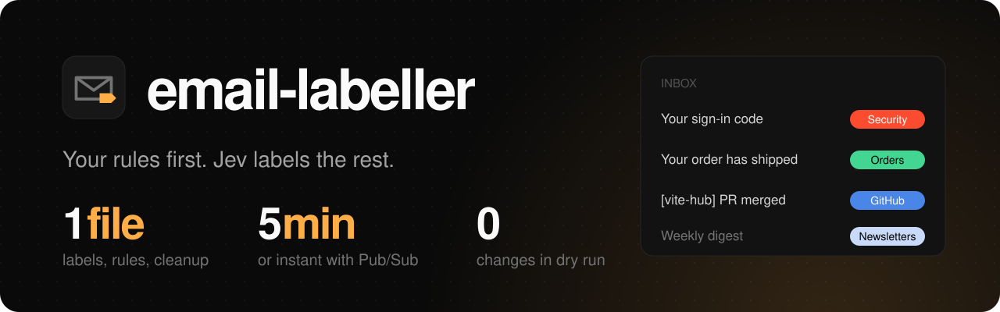

<h1>
  
</h1>

[](https://vitehub.dev)
[](https://typesafe.ai)
[](https://github.com/vite-hub/email-labeller/actions/workflows/check.yml)
[](./package.json)
[](./LICENSE)

Email labeller labels new Gmail Inbox messages from a Cloudflare Worker. Your rules run first. When no rule matches, [Jev](https://typesafe.ai), TypeSafe's classification model, picks one of your labels from their descriptions and says how sure it is. Rules can also archive, mark as read, star, or trash, and a daily cleanup trashes old labelled mail. It starts in dry-run mode and changes nothing in Gmail until you turn that off.

[How it works](#how-it-works) · [Setup](#setup) · [Labels and rules](#labels-and-rules) · [Deploy](#deploy) · [Admin API](#admin-api) · [Limits](#limits)

An independent project by [@onmax](https://github.com/onmax), built on [ViteHub](https://vitehub.dev).

## How it works

```text
Gmail watch -> Pub/Sub -> POST /gmail/push ─┐
Cron every 5 minutes ───────────────────────┴─> sync Gmail history
  -> first matching rule, or Jev when none matches
  -> apply labels and actions (live mode only) -> save the history cursor in KV
Cron daily at 04:00 UTC -> trash labelled mail older than its cleanup age
```

Gmail access goes through [Executor](https://github.com/UsefulSoftwareCo/executor), which holds and refreshes the Google OAuth credential. Jev runs through Vercel AI Gateway as [`typesafe-ai/jev`](https://vercel.com/ai-gateway/models/jev). It sees a message only when no rule matches, and gets its headers, its current labels, and at most 4,000 characters of its plain-text body. The Worker stores only its sync state in KV, never message contents or decisions.

## Setup

You need Node.js 24.15+, pnpm, an Executor v2 instance with an org-owned Gmail account and a personal access token, a Vercel AI Gateway key with access to `typesafe-ai/jev`, and a Cloudflare account.

```sh
corepack enable
pnpm install --frozen-lockfile
cp .env.example .env   # fill it in; each variable is described there
pnpm dev
```

Then, in another terminal, preview what it would do to your Inbox. Preview never changes Gmail. Use the port Vite prints:

```sh
set -a; . ./.env; set +a   # load VITEHUB_SECRET into the shell
curl -X POST http://localhost:5173/api/preview \
  -H "authorization: Bearer $VITEHUB_SECRET" -H 'content-type: application/json' \
  -d '{"query":"in:inbox","max":10}'
```

## Labels and rules

Everything the labeller does lives in [`labeller.config.ts`](./labeller.config.ts):

```ts
import type { LabellerConfig } from './server/lib/labeller.ts'

export default {
  labels: {
    GitHub: { color: { textColor: '#ffffff', backgroundColor: '#4a86e8' } },
    Promotions: {
      description: 'Marketing, discounts, coupons, and campaigns', // Jev can pick labels with a description
      color: { textColor: '#666666', backgroundColor: '#efefef' },
    },
  },
  rules: {
    github: { from: 'notifications@github.com', label: 'GitHub' },
    promotions: { hasLabel: 'CATEGORY_PROMOTIONS', label: 'Promotions' },
  },
  cleanup: {
    promotions: { label: 'Promotions', olderThan: 14 }, // days
  },
} satisfies LabellerConfig
```

- **Rules** run in order and the first match wins. A rule can match on `from`, `to` (also checks Cc and Delivered-To), `subject`, `body`, `listId`, `hasLabel`, `header` (keyed by header name), and `not` (a nested match that must fail). Every field you set must match. Text matches are case-insensitive substrings, or regular expressions written as `"/pattern/flags"`. A list matches when any item does. `hasLabel` also sees Gmail's system labels, such as `CATEGORY_PROMOTIONS`.
- **Actions** are `label`, `archive`, `read`, `star`, and `trash`. A rule with no actions leaves the message alone and skips Jev.
- **Jev** chooses among the labels that have a `description`, or none. Its label is applied only when Jev's probability is at least `LABELLER_MIN_CONFIDENCE` (default `0.6`). Jev never archives or trashes.
- **Colors** must come from [Gmail's label palette](https://developers.google.com/workspace/gmail/api/reference/rest/v1/users.labels). `Parent/Child` names nest in Gmail.
- **Cleanup** keeps starred mail and trashes up to 500 messages per rule per run. Older matches go on the next run.

The labeller creates a missing label the first time it applies it, without a color. To create labels with their colors ahead of time, run `pnpm labels:sync`. It prints what it would create or update; add `--apply` to make the changes. `--hide-unmanaged` also hides every user label not in the config from the sidebar, without removing it from any message.

Three settings guard Gmail, and all start in the safe position:

| Setting | Default | Set it to |
| --- | --- | --- |
| `LABELLER_DRY_RUN` | `true` | `false` to apply decisions. While it's `true`, nothing changes in Gmail. |
| `LABELLER_TRASH_ENABLED` | `false` | `true` to let rules with `trash: true` trash mail. Otherwise those rules still label. |
| `LABELLER_CLEANUP_ENABLED` | `false` | `true` to run the daily cleanup. |

## Deploy

This app deploys to Cloudflare Workers, the only host it has run on. ViteHub also targets Vercel, Netlify, and Node through the `preset` option in `vite.config.ts`, but they don't work for this app yet. With the pinned ViteHub preview, the Vercel build fails to bundle the cron jobs, and a plain Node server needs ViteHub's process runtime to run them.

Create a KV namespace and put its ID in `.env` as `CLOUDFLARE_KV_NAMESPACE_ID`, next to `CLOUDFLARE_ACCOUNT_ID` and, optionally, `CLOUDFLARE_WORKER_DOMAIN`. Then build, set the secrets, and deploy:

```sh
pnpm exec wrangler kv namespace create email-labeller
pnpm build
pnpm exec wrangler secret put EXECUTOR_API_KEY --config .output/server/wrangler.json
pnpm exec wrangler secret put AI_GATEWAY_API_KEY --config .output/server/wrangler.json
pnpm exec wrangler secret put VITEHUB_SECRET --config .output/server/wrangler.json
pnpm run deploy
```

If Executor sits behind Cloudflare Access, also set `CF_ACCESS_CLIENT_ID` and `CF_ACCESS_CLIENT_SECRET` as secrets. The first sync after deploying saves Gmail's current position and labels only mail that arrives after it. Use [backfill](#admin-api) for older mail.

The build copies the other settings from `.env` into the Worker config, so rebuild and redeploy after changing them. Secrets stay on the Worker across deploys.

To deploy from GitHub Actions on every push to `main`, add the non-secret settings as repository variables, a `CLOUDFLARE_API_TOKEN` secret, and the variable `DEPLOY_ENABLED=true`. Unset `LABELLER_*` variables fall back to their safe defaults, so set `LABELLER_DRY_RUN=false` there too.

**Instant delivery (optional).** Without it the Worker checks Gmail every five minutes. To react right away:

1. In the Google Cloud project of Executor's Gmail OAuth client, create a Pub/Sub topic and let `gmail-api-push@system.gserviceaccount.com` publish to it.
2. Add an [authenticated push subscription](https://cloud.google.com/pubsub/docs/authenticate-push-subscriptions) that sends to `https://<your-domain>/gmail/push`.
3. Set `GMAIL_PUBSUB_TOPIC` and `GMAIL_PUBSUB_SUBSCRIPTION` to their full names (`projects/<project>/topics/<topic>` and `projects/<project>/subscriptions/<subscription>`), `PUBSUB_AUDIENCE` to the subscription's audience, and `PUBSUB_SERVICE_ACCOUNT` to the email of its service account. Rebuild and deploy.

The Worker starts the Gmail watch on its next five-minute run and renews it before it expires. It rejects pushes without a valid Google-signed token, and starts at most one push-triggered sync per minute.

## Admin API

The `POST` endpoints require `Authorization: Bearer <VITEHUB_SECRET>`. They take a JSON body, and `query` defaults to `in:inbox`.

| Endpoint | What it does |
| --- | --- |
| `GET /api/health` | Sync status, open to anyone. Returns 503 after two failed syncs in a row. With the token, it also shows the last error and the skipped messages. |
| `POST /api/preview` | Decides messages from a Gmail `query` (`max` 10 by default, up to 50) and changes nothing. |
| `POST /api/sync` | Processes new mail since the saved cursor. Call again while it returns `"more": true`. |
| `POST /api/backfill` | Processes one search page (`query`, `max` 50 by default, up to 100, `pageToken`) or up to 100 `ids`. Repeat with the returned `nextPageToken`. Add `relabel: true` to also remove managed labels the new decision didn't pick. Follows dry-run mode. |
| `POST /api/cleanup` | Runs cleanup now. Returns only a preview while dry-run mode is on or cleanup is off. |

```sh
curl -X POST https://<your-domain>/api/backfill \
  -H "authorization: Bearer $VITEHUB_SECRET" -H 'content-type: application/json' \
  -d '{"query":"in:inbox has:nouserlabels","max":100}'
```

The ViteHub Console is at `/_vitehub`. In production it accepts only Cloudflare Access logins. Set `CF_ACCESS_TEAM_DOMAIN` and `CF_ACCESS_AUD` to your Access application; the defaults belong to the author's account.

## Limits

- It's built for one mailbox.
- Two syncs running at once can process a message twice, because KV has no lock.
- A message that fails three syncs is skipped and listed in `/api/health`. Backfill its ID to retry.
- Changing rules or label descriptions affects new mail only. Backfill with `relabel: true` to redo old mail.
- The project pins a Nitro beta and a ViteHub preview build in `pnpm-lock.yaml`.

## License

[MIT](./LICENSE)
